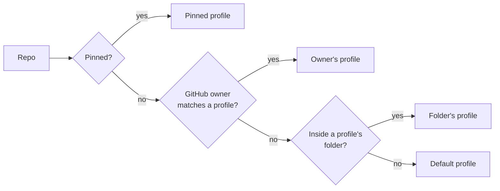

<h1 align="center">
  <picture>
    <source media="(prefers-color-scheme: dark)" srcset="brand/graphics/githop-readme-banner-dark.svg">
    
  </picture>
</h1>

<p align="center">
  <b>Work and personal git on one Windows PC — the right name, email and SSH key in every repo, automatically.</b>
</p>

<p align="center">
  
  
  
  
  
</p>

<p align="center">
  <a href="#install">Install</a> ·
  <a href="#set-up-in-the-app-10-minutes">Set up (app)</a> ·
  <a href="#set-up-from-the-command-line">Set up (CLI)</a> ·
  <a href="#command-reference">Commands</a> ·
  <a href="#troubleshooting">Troubleshooting</a> ·
  <a href="docs/user-guide.md">User guide</a>
</p>

---

## Why GitHop

Most developers have more than one git identity — a work account and a personal
one, maybe a client or two. On a single PC that goes wrong in quiet, permanent ways:

- You commit an office fix while your **personal** email is configured. The commit
  is stamped with the wrong identity **forever**, and GitHub shows your personal
  avatar on company history.
- You push a personal project and Windows signs in with your **office** account —
  `403 Permission denied`.
- You keep switching `git config --global user.email` by hand… and one day you forget.

**GitHop removes the "remember to switch" step.** Each identity becomes a
*profile* with its own name, email and SSH key. GitHop works out which profile
owns every repo — from the GitHub owner in its URL or the folder it lives in —
and **blocks commits and pushes made with the wrong identity** before they leave
your machine.

## Features

| | |
|---|---|
| 🧭 **Automatic identity per repo** | Picks the profile from the repo's GitHub owner (`github.com/acme-corp/…` → Office) or folder (`C:\Personal\…` → Personal). |
| 🛑 **Blocks mistakes** | A commit or push that would use the wrong email is stopped with a clear message — before anything reaches GitHub. |
| 🔑 **One SSH key per profile** | Generates keys, pins each repo to its profile's key, and switches HTTPS remotes to SSH so the right GitHub account pushes. |
| 🩹 **Fix, safely** | Re-stamps wrong-identity commits that aren't pushed yet. Never touches pushed commits. Always keeps a backup you can undo. |
| 🖥️ **Tray app + CLI** | A calm desktop app for everyday use, and `githop.exe` for terminals and scripts. Same engine, same rules. |
| 🔁 **Works with your tools** | Plain `git`, VS Code, any editor. Your repos' own hooks (lint, tests, husky) keep running. |
| 🔒 **Local-only & private** | No network code, no telemetry, no accounts. Every change to your git config is backed up first and can be undone. |
| ♻️ **Clean uninstall** | Removes everything and restores your original git settings exactly. |

## How it works

For every repo, GitHop decides which profile owns it, in this order:



1. **Pin** — the repo was pinned to a profile (`githop pin`, the app, or automatically on clone).
2. **Owner** — the GitHub user or organisation in the repo's `origin` URL.
3. **Folder** — the longest matching folder rule.
4. **Default profile** — the one you selected in the tray or with `githop use`.

Pinning writes the profile's `user.name`, `user.email` and SSH key into the repo's
own `.git/config`, so **plain git uses the right identity even when GitHop isn't
running**. On top of that, GitHop installs lightweight git hooks that check every
commit and push:

| Safety layer | When | What happens |
|---|---|---|
| **Auto-pin** | `git clone` | The new repo is pinned to its owner's profile: `✓ GitHop: pinned to Personal` |
| **Block commit** | `git commit` | A commit that would use another profile's email is blocked. If the repo wasn't pinned yet, GitHop pins it and asks you to run the commit again. |
| **Block push** | `git push` | A push containing any commit with your wrong email is blocked, listing those commits. Colleagues' commits are never flagged. |
| **Fix** | when you choose | Re-stamps unpushed wrong-identity commits with the right identity, keeping a backup. |

> **If GitHop itself ever has a problem, git keeps working** — you see a one-line
> warning, never a blocked commit caused by a GitHop bug.

---

## Install

**Requirements:** Windows 10 or 11 · [Git for Windows](https://git-scm.com/download/win) 2.40 or newer.
OpenSSH (built into Windows) is used for SSH keys.

1. Download **`GitHop_<version>_x64-setup.exe`** from the
   [Releases](../../releases) page
   (or [build it yourself](#build-from-source)).
2. Run it. If Windows SmartScreen says *"Windows protected your PC"*, click
   **More info → Run anyway** (the installer isn't code-signed yet).
3. Click through setup. It installs **for your Windows user only — no admin rights**:
   - `GitHopApp.exe` — the tray app
   - `githop.exe` — the command-line tool, added to your PATH (works immediately, even in terminals that are already open)
4. Leave **Open GitHop** ticked and click **Finish**. GitHop opens its first-run setup.

> 🛡️ The welcome page says it, and it's true: *GitHop works offline. It never
> connects to the internet.* The only network traffic is git and ssh doing
> **your** pushes and pulls, and the **Test connection** button when you click it.

---

## Set up in the app (10 minutes)

Have both GitHub accounts handy (for example your **office** and **personal** accounts).

### Step 1 · Get a private commit email for each GitHub account

Every commit carries an email address, and it's public on GitHub. Use GitHub's
private **noreply** address — it still links commits to your account (green
squares, avatar) without exposing your real email.

For **each** GitHub account:

1. Sign in on github.com and open **Settings → Emails**
   ([github.com/settings/emails](https://github.com/settings/emails)).
2. Turn on **Keep my email addresses private**.
3. Copy the address GitHub shows, e.g. `12345678+your-username@users.noreply.github.com`
   (the number is your account ID).
4. *Recommended:* turn on **Block command line pushes that expose my email** — a
   second safety net on GitHub's side.

> Your work account may require your company email instead — that's fine, use it
> for the Office profile.

### Step 2 · Your first profile (detected automatically)

GitHop reads the git identity already on your PC (`git config --global user.name`
and `user.email`) and pre-fills your **first profile** — usually *Office*.

| Field | What to enter | Example |
|---|---|---|
| **Label** \* | A name you'll recognise | `Office` |
| **Name** \* | Your name as it should appear on commits | `Jane Doe` |
| **Email** \* | The email for this account (Step 1) | `jane@company.com` |
| **Colour** | Tray and card colour | Blue |
| **Owns** \* | The GitHub organisations/users whose repos are this profile's | `acme-corp` |
| **Folders** | Optional: folders whose repos use this profile | `C:\Work\` |
| **SSH key** \* | Generate a new key, or choose an existing one | `~\.ssh\githop_office` |

\* Required. With two or more profiles, every profile needs **at least one owner
or folder** — that's how GitHop tells your repos apart. *Owns* is the name right
after `github.com/` in your repo URLs.

Click **Save**. GitHop backs up your git config before changing anything.

### Step 3 · Add your second profile

Click **Add profile** and fill it in the same way — e.g. **Personal**, your
personal noreply email, and your personal GitHub username under **Owns**.

### Step 4 · Create the SSH key

In each profile's **SSH key** section, click **Generate key**.

- A console window opens and asks for a **passphrase**. Type one you'll remember
  (e.g. three random words: `Mango-Rocket-Window-42` — but your own) and press
  Enter twice. GitHop never sees or stores it.
- The public key appears in the profile (`ssh-ed25519 AAAA… you@example.com`).

### Step 5 · Add the key to the right GitHub account

1. Click **Copy public key**, then **Open GitHub SSH settings**.
2. Check you're signed in to the **right account** (avatar, top right).
3. Click **New SSH key** → Title: `GitHop – my PC` → Key type: **Authentication Key** → paste → **Add SSH key**.
4. Back in GitHop, click **Test connection**. You should see
   **✓ Connected to GitHub as your-username**.

Repeat for the other profile with the other GitHub account.

### Step 6 · Remember the passphrase (once)

Click **Remember my passphrase** in each profile. Windows' SSH agent keeps it, so
**pushes from the terminal and VS Code never ask again**. If the agent is off,
the button says **Turn on and remember** and shows one Windows admin prompt.

### Step 7 · Connect your existing repos

1. Open **Repos → Scan folder** and pick the folder that holds your projects.
2. If repos show **"No owner match"**, the **Choose a profile for these GitHub
   owners** panel suggests a profile per owner — click **Add to profile**.
3. Click **Pin all**.
4. Repos that use `https://github.com/…` show **"HTTPS — signs in with Windows'
   saved account"**. Click **Switch all to SSH** so each repo pushes with its
   profile's key (undo is one click).

**Done.** Clone, commit and push exactly as before — GitHop keeps every repo on
the right identity.

---

## Set up from the command line

Everything in the app is also available from `githop`:

```powershell
# 1. Set up: back up your git config, turn your current identity into the first
#    profile, install the hooks. Safe to run again.
githop init --id office --label Office
githop edit office --owner acme-corp

# 2. Add your personal identity
githop add --id personal --label Personal --name "Jane Doe" `
  --email "12345678+janedoe@users.noreply.github.com" --owner janedoe

# 3. One SSH key per profile (prints the public key to add on GitHub)
githop keygen office
githop keygen personal

# 4. After adding each key on GitHub (Settings → SSH and GPG keys)
githop test office          # ✓ Connected as jane-acme
githop test personal        # ✓ Connected as janedoe

# 5. Pick the default profile — used for repos no owner or folder matches
githop use personal

# 6. Pin the repos you already have, and switch HTTPS remotes to SSH
githop remote policy auto
githop scan C:\Code --apply

# Check anything, any time
githop status               # inside a repo: which profile, and why
githop doctor               # whole setup: hooks, keys, ssh config, …
```

---

## Everyday use

| You want to… | Do this |
|---|---|
| Clone a repo | `git clone git@github.com:owner/repo.git` — it's pinned to the owner's profile automatically. |
| Commit and push | Plain `git commit` / `git push`, or VS Code's **Sync**. Nothing new to learn. |
| Switch the default profile | Click the **tray icon** and pick a profile, or `githop use office`. |
| See which identity a repo uses | `githop status`, or the **Repos** screen. |
| Pin a repo to a specific profile | `githop pin personal`, or **Pin** on the Repos screen. |
| Fix commits made with the wrong email | **Fix commits** screen, or `githop fix` (unpushed commits only). |
| Move profiles to another PC | **Settings → Export / Import**, or `githop export` / `githop import`. |

**When GitHop blocks a commit** you'll see something like:

```text
✗ GitHop: commit blocked
This repo belongs to Office.
Commit would use 12345678+janedoe@users.noreply.github.com.
✓ Identity fixed for this repo: pinned to Office.
Run the commit again.
```

Run the commit again — it now uses the Office identity.

---

## Command reference

`githop <command> [options]` — run `githop <command> --help` for every option.

| Command | What it does |
|---|---|
| [`init`](#init) | Set up GitHop: back up git config, create the first profile, install hooks |
| [`add`](#add--edit--remove) | Add a profile |
| [`edit`](#add--edit--remove) | Change a profile |
| [`remove`](#add--edit--remove) | Remove a profile (its SSH key is kept) |
| [`list`](#list--use) | List profiles and show the default profile |
| [`use`](#list--use) | Make a profile the default profile |
| [`status`](#status--pin--unpin) | Show which profile this repo uses, and why |
| [`pin`](#status--pin--unpin) / [`unpin`](#status--pin--unpin) | Pin this repo to a profile / remove the pin |
| [`scan`](#scan) | Find repos in a folder and show which profile owns each |
| [`keygen`](#keygen--test) | Create an SSH key for a profile and print its public key |
| [`test`](#keygen--test) | Test a profile's SSH key against GitHub |
| [`remote`](#remote) | Switch GitHub HTTPS remotes to SSH (and back) |
| [`fix`](#fix) | Fix unpushed commits that used the wrong identity |
| [`doctor`](#doctor--hooks) | Check your setup and suggest fixes |
| [`hooks`](#doctor--hooks) | Install, remove or check GitHop's git hooks |
| [`export`](#export--import) / [`import`](#export--import) | Move profiles to another PC (password-protected file) |
| [`wipe`](#wipe) | Remove GitHop and restore your original git settings |
| `check` | Used by the git hooks (you don't need to run it) |

**Global options:** `--json` (machine-readable output; see [docs/cli-json.md](docs/cli-json.md)) ·
`--no-color` · `-q, --quiet` · `-v, --verbose` · `-h, --help` · `-V, --version`

**Exit codes:** `0` ok · `1` blocked / a problem was found · `2` usage error · `3` internal error

<details>
<summary><b id="init">init</b> — first-time setup</summary>

```powershell
githop init [--id office] [--label Office] [--name "…"] [--email "…"] [--color blue] [--key <path>] [-y] [--no-hooks]
```

Backs up your global git config, creates the first profile from your current
`user.name` / `user.email` (or the values you pass), makes it the default profile
and installs the hooks. Running it again is safe — it repairs the hooks.
</details>

<details>
<summary><b id="add--edit--remove">add · edit · remove</b> — manage profiles</summary>

```powershell
githop add --id personal --label Personal --name "Jane Doe" --email "…" --owner janedoe [--folder C:\Personal] [--color violet] [--key <path>]
githop edit office --owner acme-corp --owner acme-labs     # replace owners (repeatable)
githop edit office --email new@company.com --repin         # re-pin repos using this profile
githop remove personal [--new-default office] [-y]
```

- `--owner` / `--folder` can be repeated. With two or more profiles, each needs at least one.
- `edit --no-owners` / `--no-folders` clears them.
- `remove` keeps the SSH key file; pinned repos are reported so you can re-pin them.
</details>

<details>
<summary><b id="list--use">list · use</b> — see and switch the default profile</summary>

```powershell
githop list
githop use personal
```

`use` sets your global `user.name`, `user.email` and SSH key — the identity for
repos that no owner or folder rule matches. Pinned repos keep their own profile.
</details>

<details>
<summary><b id="status--pin--unpin">status · pin · unpin</b> — one repo</summary>

```powershell
githop status            # profile, why (pin / owner / folder / default), identity, key, warnings
githop pin office        # this repo always uses Office
githop unpin
```

Pinning offers to switch a GitHub HTTPS remote to SSH (see [`remote`](#remote)).
</details>

<details>
<summary><b id="scan">scan</b> — many repos at once</summary>

```powershell
githop scan C:\Code                 # show every repo and its profile
githop scan C:\Code --apply         # pin repos matched by an owner or folder rule
githop scan C:\Code --apply --include-default   # also pin repos only the default matches
githop scan C:\ --depth 6
```

The summary groups unmatched repos by GitHub owner and tells you which
`githop edit <profile> --owner <org>` would cover them.
</details>

<details>
<summary><b id="keygen--test">keygen · test</b> — SSH keys</summary>

```powershell
githop keygen personal              # creates ~/.ssh/githop_personal, asks for a passphrase
githop keygen personal --no-passphrase
githop test personal                # ✓ Connected as janedoe   (connects to github.com)
```

The private key is locked to your Windows user. GitHop never sees the passphrase.
</details>

<details>
<summary><b id="remote">remote</b> — HTTPS → SSH</summary>

```powershell
githop remote ssh                   # switch this repo's GitHub HTTPS remotes to SSH
githop remote ssh --all-in C:\Code  # every repo in a folder
githop remote undo                  # put the HTTPS URLs back
githop remote policy auto           # pinning switches without asking (ask | auto | never)
```

Over HTTPS, git signs in with the account Windows saved — not your profile's
key — so a personal repo can push as your office account (`403`). SSH fixes that.
</details>

<details>
<summary><b id="fix">fix</b> — repair wrong-identity commits</summary>

```powershell
githop fix --dry-run      # show what would change
githop fix                # re-stamp unpushed wrong-identity commits
githop fix --undo         # restore the backup from the last fix
```

Only commits that aren't on any remote are changed, and only those using **your
other** identities — a colleague's commits keep their author. A backup is saved
first. Pushed commits are never rewritten.
</details>

<details>
<summary><b id="doctor--hooks">doctor · hooks</b> — health checks</summary>

```powershell
githop doctor             # hooks, keys, ssh config conflicts, ssh-agent, PATH, profiles…
githop hooks status
githop hooks install      # install or repair
githop hooks uninstall    # restore your previous core.hooksPath
githop hooks snippet commit   # line for repos with their own hooks (husky, lefthook)
```
</details>

<details>
<summary><b id="export--import">export · import</b> — another PC</summary>

```powershell
githop export profiles.githop [--include-keys]
githop import profiles.githop [--on-conflict skip|replace|rename]
```

The file is encrypted with a password you choose (at least 12 characters). SSH
keys are only included with `--include-keys` and keep their own passphrases.
</details>

<details>
<summary><b id="wipe">wipe</b> — remove GitHop</summary>

```powershell
githop wipe [--yes] [--delete-keys] [--keep-pins] [--keep-data]
```

Removes GitHop's hooks (restoring any hooks folder you had before), puts back
your original global name, email and SSH setting, optionally unpins repos, and
deletes GitHop's data. SSH keys are kept unless you add `--delete-keys`.
Interrupted? Run it again — it picks up where it stopped.
</details>

### Settings and environment variables

| Setting | Where | Values |
|---|---|---|
| Enforce mode | App: **Settings** · file: `%APPDATA%\githop\settings.toml` → `enforce` | `block` (default) · `warn` · `block-strict` |
| HTTPS remotes on pin | App: **Settings → GitHub HTTPS remotes** · `githop remote policy` | `ask` (default) · `auto` · `never` |
| Logging (opt-in) | App: **Settings** | No emails, paths or URLs are ever logged |
| Start with Windows | App: **Settings** | On after setup |

| Variable | Effect |
|---|---|
| `GITHOP_DISABLE=1` | Skip GitHop's checks for one command (like `--no-verify`, for GitHop only) |
| `NO_COLOR=1` | Plain output without colours |
| `GITHOP_ASCII=1` | `[ok]` / `[blocked]` instead of ✓ / ✗ |
| `GITHOP_HOME` | Use another data folder (handy for testing) |

---

## Troubleshooting

<details>
<summary><b>"githop is not recognized"</b></summary>

The installer adds GitHop to your PATH and a small launcher that works in
PowerShell and cmd immediately. In **Git Bash** inside an editor that was open
before the install, type `githop.cmd`, or fully quit the editor (VS Code:
**File → Exit**, and make sure no `Code.exe` is left in Task Manager) and reopen it.
</details>

<details>
<summary><b>"Permission to owner/repo.git denied to <other-account>" (403)</b></summary>

The repo uses an `https://` remote, so Windows signed in with the account it saved.
Open **Repos** and click **Switch to SSH** (or run `githop remote ssh`), then push again.
</details>

<details>
<summary><b>"Permission denied (publickey)"</b></summary>

GitHub doesn't know this profile's key yet. In the profile, click **Copy public
key → Open GitHub SSH settings**, add it to the **right account**, then **Test connection**.
</details>

<details>
<summary><b>Asked for the passphrase on every push / VS Code push hangs</b></summary>

Click **Remember my passphrase** in the profile. VS Code can't show a passphrase
prompt; with the passphrase in Windows' SSH agent it doesn't need to.
</details>

<details>
<summary><b>"push blocked — N commits use the Office email in a Personal repo"</b></summary>

Those commits were made with the wrong identity. Open **Fix commits** (or run
`githop fix`) to re-stamp them — only unpushed commits are changed, with a backup —
then push again.
</details>

<details>
<summary><b>A repo shows "No owner match" / uses the default profile</b></summary>

No profile lists that repo's GitHub owner. Use the **Choose a profile for these
GitHub owners** panel on the Repos screen, or `githop edit office --owner <org>`.
</details>

<details>
<summary><b>Repos with husky, lefthook or pre-commit</b></summary>

These set their own `core.hooksPath`, which skips global hooks. `githop status`
points them out; add the line from `githop hooks snippet commit` to the top of the
repo's pre-commit hook (and `snippet push` to its pre-push hook).
</details>

Still stuck? Run `githop doctor` — every problem it finds comes with a one-line fix.
More in the [user guide](docs/user-guide.md).

---

## Privacy and security

- **No network code.** GitHop never makes a network request. The dependency tree
  is checked with `cargo deny`, which bans HTTP and WebSocket client libraries.
- **No telemetry, analytics, crash reporting, accounts or auto-updater.**
- **No secrets stored.** Only the *paths* to your SSH keys — never passwords,
  tokens or passphrases.
- **Everything is reversible.** Your git config is backed up before every change;
  `githop wipe` (or uninstalling) restores it.
- **Never rewrites pushed history.** Fix only touches commits that aren't on any remote.

### Known limits

- Git keeps names, emails and key paths in plain-text config — anyone with access
  to your Windows account can read them.
- On a managed office PC, IT tools can see network traffic to GitHub. No app can hide that.
- Commit emails are public once pushed — use GitHub's noreply address for personal work.
- `--no-verify`, `GITHOP_DISABLE=1` and tools that don't run git hooks bypass the checks.
- Personal work on an employer's hardware may be owned or monitored by the employer —
  check your contract and IT policy.

---

## Uninstall

Any of these restores your original git setup:

- **Windows Settings → Apps → Installed apps → GitHop → Uninstall**
  (tick *Delete the application data* to remove profiles and backups too)
- **In the app:** Settings → **Wipe GitHop**
- **Command line:** `githop wipe`

Your SSH keys are always kept unless you explicitly choose to delete them.

---

## Build from source

**Requirements:** Rust (MSVC toolchain) · Git for Windows ≥ 2.40 · Node.js LTS (for the app)

```powershell
# Core library and CLI
cargo build --release
cargo test                                   # runs in an isolated git environment
cargo clippy --all-targets -- -D warnings
cargo deny check                             # licences, advisories, banned network crates

# Tray app and installer
npm --prefix app/ui ci
npm --prefix app ci
cd app
npm run tauri dev                            # run the app
npm run build:installer                      # → target/release/bundle/nsis/GitHop_<ver>_x64-setup.exe
```

### Project layout

```text
crates/githop-core/   core library: profiles, resolver, git config, hooks, checks, fix
crates/githop-cli/    githop.exe — the command-line tool and git hook entry point
app/src-tauri/        GitHopApp.exe — Tauri 2 tray app and NSIS installer
app/ui/               React + TypeScript + Tailwind screens
brand/                logo, icons and usage rules (brand/README.md)
docs/                 user guide, CLI JSON schemas, architecture decisions
```

Contributions are welcome — please run the checks above before opening a pull request,
and read [docs/decisions/](docs/decisions/) for the reasoning behind the design.

## Licence

Dual-licensed under **MIT** ([LICENSE-MIT](LICENSE-MIT)) or **Apache-2.0**
([LICENSE-APACHE](LICENSE-APACHE)), at your option. Third-party notices:
[THIRD-PARTY-LICENSES.md](THIRD-PARTY-LICENSES.md).

<p align="center">
  <br>
  <sub>One PC. Every git identity. No mix-ups.</sub>
</p>
