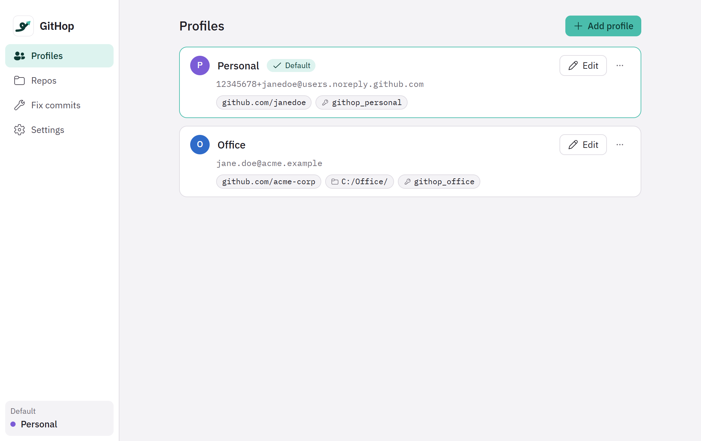
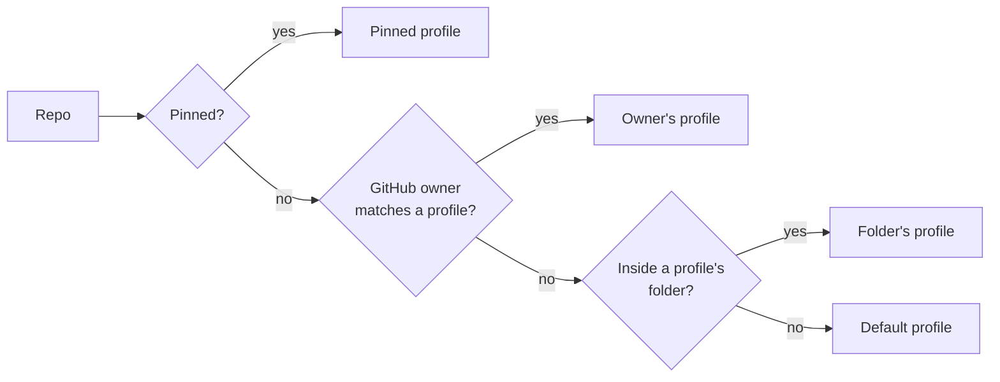
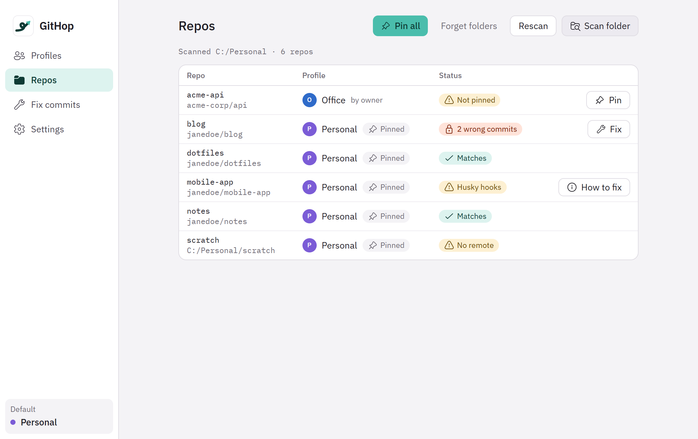

<h1 align="center">
  <picture>
    <source media="(prefers-color-scheme: dark)" srcset="brand/graphics/githop-readme-banner-dark.svg">
    
  </picture>
</h1>

<p align="center">
  <b>Every git identity on one Windows PC: work, personal, clients, open source. The right name, email and SSH key in every repo, automatically.</b>
</p>

<p align="center">
  
  
  
  
  
</p>

<p align="center">
  <a href="#install">Install</a> ·
  <a href="#the-githop-app">The app</a> ·
  <a href="#set-up-in-the-app-10-minutes">Set up</a> ·
  <a href="#everyday-use">Everyday use</a> ·
  <a href="#for-terminal-users">Command line</a> ·
  <a href="#troubleshooting">Troubleshooting</a> ·
  <a href="docs/user-guide.md">User guide</a>
</p>

<p align="center">
  
</p>

---

## Why GitHop

Most developers have more than one git identity: a job, personal projects,
maybe a client or two. On a single PC that goes wrong in quiet, permanent ways:

- You commit a work fix while your **personal** email is configured. The commit
  is stamped with the wrong identity **forever**, and GitHub shows your personal
  avatar on company history.
- You push a personal project and Windows signs in with your **work** account:
  `403 Permission denied`.
- You keep switching `git config --global user.email` by hand, and one day you forget.

**GitHop removes the "remember to switch" step.** Each identity becomes a
*profile* with its own name, email and SSH key. GitHop works out which profile
owns every repo, from the GitHub owner in its URL or the folder it lives in,
and **blocks commits and pushes made with the wrong identity** before they leave
your machine.

## Features

| | |
|---|---|
| 🧭 **Automatic identity per repo** | Picks the profile from the repo's GitHub owner (`github.com/acme-corp/…` → Work) or folder (`C:\Personal\…` → Personal). |
| 🛑 **Blocks mistakes** | A commit or push that would use the wrong email is stopped with a clear message, before anything reaches GitHub. |
| 🔑 **One SSH key per profile** | Generates keys, pins each repo to its profile's key, and switches HTTPS remotes to SSH so the right GitHub account pushes. |
| 🩹 **Fix, safely** | Re-stamps wrong-identity commits that aren't pushed yet. Never touches pushed commits. Always keeps a backup you can undo. |
| 🖥️ **Tray app + CLI** | A calm desktop app for everyday use, and `githop.exe` for terminals and scripts. Same engine, same rules. |
| 🔁 **Works with your tools** | Plain `git`, VS Code, any editor. Your repos' own hooks (lint, tests, husky) keep running. |
| 🔒 **Local-only and private** | No network code, no telemetry, no accounts. Every change to your git config is backed up first and can be undone. |
| ♻️ **Clean uninstall** | Removes everything and restores your original git settings exactly. |

## How it works

For every repo, GitHop decides which profile owns it, in this order:



1. **Pin:** the repo was pinned to a profile (in the app, with `githop pin`, or automatically on clone).
2. **Owner:** the GitHub user or organisation in the repo's `origin` URL.
3. **Folder:** the longest matching folder rule.
4. **Default profile:** the one you selected in the tray or with `githop use`.

Pinning writes the profile's `user.name`, `user.email` and SSH key into the repo's
own `.git/config`, so **plain git uses the right identity even when GitHop isn't
running**. On top of that, GitHop installs lightweight git hooks that check every
commit and push:

| Safety layer | When | What happens |
|---|---|---|
| **Auto-pin** | `git clone` | The new repo is pinned to its owner's profile: `✓ GitHop: pinned to Personal` |
| **Block commit** | `git commit` | A commit that would use another profile's email is blocked. If the repo wasn't pinned yet, GitHop pins it and asks you to run the commit again. |
| **Block push** | `git push` | A push containing any commit with your wrong email is blocked, listing those commits. Colleagues' commits are never flagged. |
| **Fix** | When you choose | Re-stamps unpushed wrong-identity commits with the right identity, keeping a backup. |

> **If GitHop itself ever has a problem, git keeps working.** You see a one-line
> warning, never a blocked commit caused by a GitHop bug.

---

## Install

**Requirements:** Windows 10 or 11 · [Git for Windows](https://git-scm.com/download/win) 2.40 or newer.
OpenSSH (built into Windows) is used for SSH keys.

1. Download **`GitHop_<version>_x64-setup.exe`** from the
   [Releases](../../releases) page
   (or [build it yourself](#build-from-source)).
2. Run it. If Windows SmartScreen says *"Windows protected your PC"*, click
   **More info → Run anyway** (the installer isn't code-signed yet).
3. Click through setup. It installs **for your Windows user only, no admin rights**:
   - `GitHopApp.exe`: the tray app
   - `githop.exe`: the command-line tool, added to your PATH (works immediately, even in terminals that are already open)
4. Leave **Open GitHop** ticked and click **Finish**. GitHop opens its first-run setup.

> 🛡️ The welcome page says it, and it's true: *GitHop works offline. It never
> connects to the internet.* The only network traffic is git and ssh doing
> **your** pushes and pulls, and the **Test connection** button when you click it.

---

## The GitHop app

GitHop lives in your **system tray** and starts with Windows. Everything you need
day to day is in the app, so you never have to open a terminal.

### 🎯 Tray icon and menu

- The tray icon shows your **default profile** as a coloured circle with its
  initial, so you always know which identity new repos will use.
- A small dot appears when GitHop **recently blocked** a commit or push, and the
  GitHop logo shows when setup isn't finished or something needs attention.
- **Left-click** opens a quick menu: switch the default profile in one click, or
  open the main window. **Right-click** gives Open GitHop and Quit.
- Closing the window keeps GitHop running in the tray. Your checks keep working
  even when the app is closed.

### ✨ First-run setup

A short guided setup (six steps) that you can leave and resume:

1. **Welcome:** what GitHop does, and its promise to stay offline.
2. **Your first profile:** pre-filled from the git identity already on your PC,
   asking which GitHub organisation or account owns its repos.
3. **Safety backup:** your git config is backed up before anything changes.
4. **Another profile:** add your second identity (and fix the first one's owner in place if needed).
5. **Protection:** one click installs the commit and push checks.
6. **Done:** you're protected.

### 👤 Profiles

Your identities as cards: colour, label, email, owners, folders and key at a glance.

- **Add profile** and **Edit** open a clear form. Required fields are marked, and
  mistakes are explained right under the field.
- **SSH key panel:** **Generate key**, **Use existing key file**, **Copy public key**,
  **Open GitHub SSH settings**, **Test connection** (shows
  *"✓ Connected to GitHub as …"* right on the card) and **Remember my passphrase**.
- The passphrase is typed in the form; the key is remembered by Windows' SSH agent
  as soon as it's created. **Sign my commits** gives a profile's commits GitHub's
  Verified badge.
- Warns you if a key belongs to a different GitHub account than the profile owns.
- **Make default**, **Test connection** and **Delete** from each card's menu.

### 📁 Repos

See every repo on your PC and the identity it uses.

<p align="center">
  
</p>

- **Scan folder** finds your repos. Each row shows its profile, why it was chosen
  (pin, owner, folder or default) and a status pill.
- **Choose a profile for these GitHub owners:** when repos match no profile,
  GitHop groups them by GitHub owner and suggests the right profile.
  One click per owner.
- **Pin** and **Pin all** lock repos to their profile.
- **Switch to SSH** and **Switch all to SSH** for repos that would otherwise push
  with Windows' saved account. Undo is one click.
- Repos with their own hooks (husky and friends) get a **How to fix** guide.

### 🩹 Fix commits

Pick a repo and see exactly which commits used the wrong identity.

- Unpushed and already-pushed commits are shown separately. **Only unpushed
  ones are ever changed**, and other people's commits keep their author.
- **Fix with &lt;profile&gt; identity** re-stamps them. A backup is saved first and
  **Undo** puts everything back.
- Tells you clearly whether a plain push will work afterwards.

### ⚙️ Settings

- **Enforce mode:** Block (default), Warn, or Strict.
- **GitHub HTTPS remotes:** switch to SSH automatically, ask, or leave them.
- **Start with Windows**, opt-in **logging**.
- **Export** and **Import** profiles to a password-protected file for another PC.
- **Diagnostics:** **Run doctor** checks hooks, git, SSH and your config, with a
  fix for each problem. **Save diagnostics file** for sharing.
- **About**, licences, and **Wipe GitHop** (type `WIPE` to confirm) to remove
  everything and restore your original git settings.

> The app is keyboard-friendly (`Ctrl+1` to `Ctrl+4` switch screens, `Ctrl+N` adds a
> profile), works with Windows text scaling and contrast themes, and respects
> "reduce motion".

---

## Set up in the app (10 minutes)

Have each GitHub account handy (for example **work**, **personal** or a **client**'s). The steps below use two profiles; add as many as you need.

### Step 1 · Get a private commit email for each GitHub account

Every commit carries an email address, and it's public on GitHub. Use GitHub's
private **noreply** address. It still links commits to your account (green
squares, avatar) without exposing your real email.

For **each** GitHub account:

1. Sign in on github.com and open **Settings → Emails**
   ([github.com/settings/emails](https://github.com/settings/emails)).
2. Turn on **Keep my email addresses private**.
3. Copy the address GitHub shows, for example `12345678+your-username@users.noreply.github.com`
   (the number is your account ID).
4. *Recommended:* turn on **Block command line pushes that expose my email**. It's a
   second safety net on GitHub's side.

> Your work account may require your company email instead. That's fine, use it
> for the Work profile.

### Step 2 · Your first profile (detected automatically)

GitHop reads the git identity already on your PC (`git config --global user.name`
and `user.email`) and pre-fills your **first profile**. The label is suggested from your email (*Acme* for jane@acme.com, *Personal* for a Gmail or noreply address) and you can change it.

| Field | What to enter | Example |
|---|---|---|
| **Label** \* | Any name you'll recognise | `Work`, `Personal`, `Client`, `Open source` |
| **Name** \* | Your name as it should appear on commits | `Jane Doe` |
| **Email** \* | The email for this account (Step 1) | `jane@company.com` |
| **Colour** | Tray and card colour | Blue |
| **Owns** \* | The GitHub organisations or users whose repos are this profile's | `acme-corp` |
| **Folders** | Optional: folders whose repos use this profile | `C:\Work\` |
| **SSH key** \* | Generate a new key, or choose an existing one | `~\.ssh\githop_office` |

\* Required. With two or more profiles, every profile needs **at least one owner
or folder**; that's how GitHop tells your repos apart. *Owns* is the name right
after `github.com/` in your repo URLs.

Click **Save**. GitHop backs up your git config before changing anything.

### Step 3 · Add your second profile

Click **Add profile** and fill it in the same way: for example **Personal**, your
personal noreply email, and your personal GitHub username under **Owns**.

### Step 4 · Create the SSH key

In each profile's **SSH key** section:

1. Type a **passphrase** twice, right in the form. Pick one you'll remember (for
   example three random words plus a number, like `Mango-Rocket-Window-42`, but
   your own).
2. Click **Generate key**.

GitHop creates the key and hands it to Windows' SSH agent in the same step, so
**pushes from the terminal and VS Code never ask for the passphrase**. Your
passphrase is used once in memory and never saved. If the agent is off, Windows
shows one admin prompt to turn it on. The public key then appears in the profile
(`ssh-ed25519 AAAA… you@example.com`).

### Step 5 · Add the key to the right GitHub account

The app walks you through it under **Add this key to GitHub**:

1. Click **Copy public key**, then **Open GitHub SSH settings** (it opens GitHub's
   "Add new SSH key" page).
2. Check you're signed in to the **right account** (avatar, top right).
3. Title: `GitHop (Work)` (there's a **Copy** button). Key type: **Authentication Key**. Paste the key and click **Add SSH key**.
4. Back in GitHop, click **Test connection**. You should see
   **✓ Connected to GitHub as your-username**.

Repeat for the other profile with the other GitHub account.

### Step 6 · Optional: signed commits (Verified badge)

Tick **Sign my commits** in a profile and GitHub shows its commits as
**Verified**. The app adds one more step: add the same public key on GitHub a
second time, with Key type **Signing Key**. It uses the profile's SSH key, so
there's nothing new to manage (needs Git 2.34 or newer).

### Step 7 · Connect your existing repos

1. Open **Repos → Scan folder** and pick the folder that holds your projects.
2. If repos show **"No owner match"**, the **Choose a profile for these GitHub
   owners** panel suggests a profile per owner. Click **Add to profile**.
3. Click **Pin all**.
4. Repos that use `https://github.com/…` show **"HTTPS: signs in with Windows'
   saved account"**. Click **Switch all to SSH** so each repo pushes with its
   profile's key (undo is one click).

**Done.** Clone, commit and push exactly as before. GitHop keeps every repo on
the right identity.

---

## Everyday use

| You want to… | In the app | From a terminal |
|---|---|---|
| Clone a repo | Nothing to do: it's pinned to the owner's profile automatically | `git clone git@github.com:owner/repo.git` |
| Commit and push | Nothing new: use git or VS Code's **Sync** as always | `git commit` and `git push` |
| Switch the default profile | **Tray icon** → pick a profile | `githop use work` |
| See which identity a repo uses | **Repos** screen | `githop status` |
| Pin a repo to a profile | **Repos → Pin** | `githop pin personal` |
| Use the profile's key for an HTTPS repo | **Repos → Switch to SSH** | `githop remote ssh` |
| Fix commits made with the wrong email | **Fix commits** screen | `githop fix` |
| Check your setup | **Settings → Run doctor** | `githop doctor` |
| Move profiles to another PC | **Settings → Export / Import** | `githop export` and `githop import` |

**When GitHop blocks a commit** you'll see something like:

```text
✗ GitHop: commit blocked
This repo belongs to Work.
Commit would use 12345678+janedoe@users.noreply.github.com.
✓ Identity fixed for this repo: pinned to Work.
Run the commit again.
```

Run the commit again. It now uses the Work identity.

---

## For terminal users

Everything in the app is also available from `githop.exe`: handy for scripts,
servers, or if you simply prefer the terminal.

### Set up from the command line

```powershell
# 1. Set up: back up your git config, turn your current identity into the first
#    profile, install the hooks. Safe to run again.
githop init --id work --label Work
githop edit work --owner acme-corp

# 2. Add your personal identity
githop add --id personal --label Personal --name "Jane Doe" `
  --email "12345678+janedoe@users.noreply.github.com" --owner janedoe

# 3. One SSH key per profile (prints the public key to add on GitHub)
githop keygen work
githop keygen personal

# 4. After adding each key on GitHub (Settings → SSH and GPG keys)
githop test work            # ✓ Connected as jane-acme
githop test personal        # ✓ Connected as janedoe

# 5. Pick the default profile, used for repos no owner or folder matches
githop use personal

# 6. Pin the repos you already have, and switch HTTPS remotes to SSH
githop remote policy auto
githop scan C:\Code --apply

# Check anything, any time
githop status               # inside a repo: which profile, and why
githop doctor               # whole setup: hooks, keys, ssh config, …
```

### Command reference

Usage: `githop <command> [options]`. Run `githop <command> --help` for every option.

**Global options:** `--json` (machine-readable output, see [docs/cli-json.md](docs/cli-json.md)) ·
`--no-color` · `-q, --quiet` · `-v, --verbose` · `-h, --help` · `-V, --version`

**Exit codes:** `0` ok · `1` blocked or a problem was found · `2` usage error · `3` internal error

#### First-time setup: `init`

```powershell
githop init [--id work] [--label Work] [--name "…"] [--email "…"] [--color blue] [--key <path>] [-y] [--no-hooks]
```

Backs up your global git config, creates the first profile from your current
`user.name` and `user.email` (or the values you pass), makes it the default profile
and installs the hooks. Running it again is safe: it repairs the hooks.

#### Manage profiles: `add`, `edit`, `remove`

```powershell
githop add --id personal --label Personal --name "Jane Doe" --email "…" --owner janedoe [--folder C:\Personal] [--color violet] [--key <path>] [--sign]
githop edit work --owner acme-corp --owner acme-labs       # replace owners (repeatable)
githop edit work --email new@company.com --repin           # re-pin repos using this profile
githop edit work --no-owners                               # clear owners (also --no-folders)
githop edit work --sign                                    # sign commits (Verified on GitHub); --no-sign to stop
githop remove personal [--new-default work] [-y]
```

- `--owner` and `--folder` can be repeated. With two or more profiles, each needs at least one.
- `remove` keeps the SSH key file. Pinned repos are reported so you can re-pin them.

#### Default profile: `list`, `use`

```powershell
githop list                 # all profiles, default marked
githop use personal         # make Personal the default profile
```

`use` sets your global `user.name`, `user.email` and SSH key: the identity for
repos that no owner or folder rule matches. Pinned repos keep their own profile.

#### One repo: `status`, `pin`, `unpin`

```powershell
githop status               # profile, why (pin, owner, folder or default), identity, key, warnings
githop pin work             # this repo always uses Work
githop unpin                # remove the pin
```

Pinning offers to switch a GitHub HTTPS remote to SSH (see `remote` below).

#### Many repos: `scan`

```powershell
githop scan C:\Code                             # show every repo and its profile
githop scan C:\Code --apply                     # pin repos matched by an owner or folder rule
githop scan C:\Code --apply --include-default   # also pin repos only the default matches
githop scan C:\ --depth 6                       # search deeper
```

The summary groups unmatched repos by GitHub owner and tells you which
`githop edit <profile> --owner <org>` would cover them.

#### SSH keys: `keygen`, `test`

```powershell
githop keygen personal                  # creates ~/.ssh/githop_personal, asks for a passphrase
githop keygen personal --no-passphrase  # key without a passphrase
githop test personal                    # ✓ Connected as janedoe (connects to github.com)
```

The private key is locked to your Windows user. GitHop never sees the passphrase.

#### HTTPS to SSH: `remote`

```powershell
githop remote ssh                   # switch this repo's GitHub HTTPS remotes to SSH
githop remote ssh --all-in C:\Code  # every repo in a folder
githop remote undo                  # put the HTTPS URLs back
githop remote policy auto           # pinning switches without asking (ask, auto or never)
```

Over HTTPS, git signs in with the account Windows saved, not your profile's
key, so a personal repo can push as your work account (`403`). SSH fixes that.

#### Repair commits: `fix`

```powershell
githop fix --dry-run        # show what would change
githop fix                  # re-stamp unpushed wrong-identity commits
githop fix --undo           # restore the backup from the last fix
```

Only commits that aren't on any remote are changed, and only those using **your
other** identities. A colleague's commits keep their author. A backup is saved
first. Pushed commits are never rewritten.

#### Health checks: `doctor`, `hooks`

```powershell
githop doctor                   # hooks, keys, ssh config conflicts, ssh-agent, PATH, profiles
githop hooks status             # are the hooks installed and current?
githop hooks install            # install or repair
githop hooks uninstall          # restore your previous core.hooksPath
githop hooks snippet commit     # line for repos with their own hooks (husky, lefthook)
```

#### Another PC: `export`, `import`

```powershell
githop export profiles.githop [--include-keys]
githop import profiles.githop [--on-conflict skip|replace|rename]
```

The file is encrypted with a password you choose (at least 12 characters). SSH
keys are only included with `--include-keys` and keep their own passphrases.

#### Remove GitHop: `wipe`

```powershell
githop wipe [--yes] [--delete-keys] [--keep-pins] [--keep-data]
```

Removes GitHop's hooks (restoring any hooks folder you had before), puts back
your original global name, email and SSH setting, optionally unpins repos, and
deletes GitHop's data. SSH keys are kept unless you add `--delete-keys`.
Interrupted? Run it again; it picks up where it stopped.

#### Used by the hooks: `check`

`githop check` is what the git hooks call. You don't need to run it yourself.

### Settings and environment variables

Most people change settings in the app (**Settings** screen). These are the same
settings for terminal users and scripts.

| Setting | Where | Values |
|---|---|---|
| Enforce mode | App: **Settings** · file: `%APPDATA%\githop\settings.toml` → `enforce` | `block` (default) · `warn` · `block-strict` |
| HTTPS remotes on pin | App: **Settings → GitHub HTTPS remotes** · `githop remote policy` | `ask` (default) · `auto` · `never` |
| Logging (opt-in) | App: **Settings** | No emails, paths or URLs are ever logged |
| Start with Windows | App: **Settings** | On after setup |

| Variable | Effect |
|---|---|
| `GITHOP_DISABLE=1` | Skip GitHop's checks for one command (like `--no-verify`, for GitHop only) |
| `NO_COLOR=1` | Plain output without colours |
| `GITHOP_ASCII=1` | `[ok]` and `[blocked]` instead of ✓ and ✗ |
| `GITHOP_HOME` | Use another data folder (handy for testing) |

---

## Troubleshooting

#### "githop is not recognized"

The installer adds GitHop to your PATH and a small launcher that works in
PowerShell and cmd immediately. In **Git Bash** inside an editor that was open
before the install, type `githop.cmd`, or fully quit the editor (VS Code:
**File → Exit**, and make sure no `Code.exe` is left in Task Manager) and reopen it.

#### "Permission to owner/repo.git denied to other-account" (403)

The repo uses an `https://` remote, so Windows signed in with the account it saved.
Open **Repos** and click **Switch to SSH**, then push again. From a terminal:

```powershell
githop remote ssh
```

#### "Permission denied (publickey)"

GitHub doesn't know this profile's key yet. In the profile, click **Copy public
key → Open GitHub SSH settings**, add it to the **right account**, then click **Test connection**.

#### Asked for the passphrase on every push, or VS Code push hangs

VS Code can't show a passphrase prompt, so its push fails (sometimes with
`Git: CreateProcessW failed error:193`). Open the profile, type the key's
passphrase under **Remember my passphrase** and click the button. With the key in
Windows' SSH agent, nothing needs to ask.

#### "push blocked: N commits use the Work email in a Personal repo"

Those commits were made with the wrong identity. Open **Fix commits** to re-stamp
them (only unpushed commits are changed, with a backup), then push again.
From a terminal:

```powershell
githop fix --dry-run
githop fix
```

#### A repo shows "No owner match" or uses the default profile

No profile lists that repo's GitHub owner. Use the **Choose a profile for these
GitHub owners** panel on the Repos screen. From a terminal:

```powershell
githop edit work --owner <org>
```

#### Repos with husky, lefthook or pre-commit

These set their own `core.hooksPath`, which skips global hooks. `githop status`
points them out. Add the line printed by these commands to the top of the repo's
pre-commit and pre-push hooks:

```powershell
githop hooks snippet commit
githop hooks snippet push
```

Still stuck? Open **Settings → Run doctor** in the app, or run `githop doctor`.
Every problem it finds comes with a one-line fix.
More in the [user guide](docs/user-guide.md).

---

## Privacy and security

- **No network code.** GitHop never makes a network request. The dependency tree
  is checked with `cargo deny`, which bans HTTP and WebSocket client libraries.
- **No telemetry, analytics, crash reporting, accounts or auto-updater.**
- **No secrets stored.** Only the *paths* to your SSH keys, never passwords,
  tokens or passphrases.
- **Everything is reversible.** Your git config is backed up before every change;
  `githop wipe` (or uninstalling) restores it.
- **Never rewrites pushed history.** Fix only touches commits that aren't on any remote.

### Known limits

- Git keeps names, emails and key paths in plain-text config. Anyone with access
  to your Windows account can read them.
- On a managed office PC, IT tools can see network traffic to GitHub. No app can hide that.
- Commit emails are public once pushed. Use GitHub's noreply address for personal work.
- `--no-verify`, `GITHOP_DISABLE=1` and tools that don't run git hooks bypass the checks.
- Personal work on an employer's hardware may be owned or monitored by the employer.
  Check your contract and IT policy.

---

## Uninstall

Any of these restores your original git setup:

- **Windows Settings → Apps → Installed apps → GitHop → Uninstall**
  (tick *Delete the application data* to remove profiles and backups too)
- **In the app:** Settings → **Wipe GitHop**
- **Command line:** `githop wipe`

Your SSH keys are always kept unless you explicitly choose to delete them.

---

## Build from source

**Requirements:** Rust (MSVC toolchain) · Git for Windows 2.40 or newer · Node.js LTS (for the app)

```powershell
# Core library and CLI
cargo build --release
cargo test                                   # runs in an isolated git environment
cargo clippy --all-targets -- -D warnings
cargo deny check                             # licences, advisories, banned network crates

# Tray app and installer
npm --prefix app/ui ci
npm --prefix app ci
cd app
npm run tauri dev                            # run the app
npm run build:installer                      # → target/release/bundle/nsis/GitHop_<ver>_x64-setup.exe
```

### Project layout

```text
crates/githop-core/   core library: profiles, resolver, git config, hooks, checks, fix
crates/githop-cli/    githop.exe: the command-line tool and git hook entry point
app/src-tauri/        GitHopApp.exe: Tauri 2 tray app and NSIS installer
app/ui/               React + TypeScript + Tailwind screens
brand/                logo, icons and usage rules (brand/README.md)
docs/                 user guide, CLI JSON schemas, architecture decisions, README images
```

Contributions are welcome. Please run the checks above before opening a pull request,
and read [docs/decisions/](docs/decisions/) for the reasoning behind the design.

## Licence

Dual-licensed under **MIT** ([LICENSE-MIT](LICENSE-MIT)) or **Apache-2.0**
([LICENSE-APACHE](LICENSE-APACHE)), at your option. Third-party notices:
[THIRD-PARTY-LICENSES.md](THIRD-PARTY-LICENSES.md).

<p align="center">
  <br>
  <sub>One PC. Every git identity. No mix-ups.</sub>
</p>
